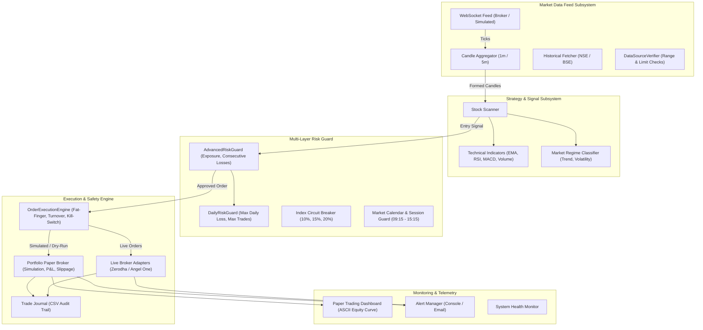
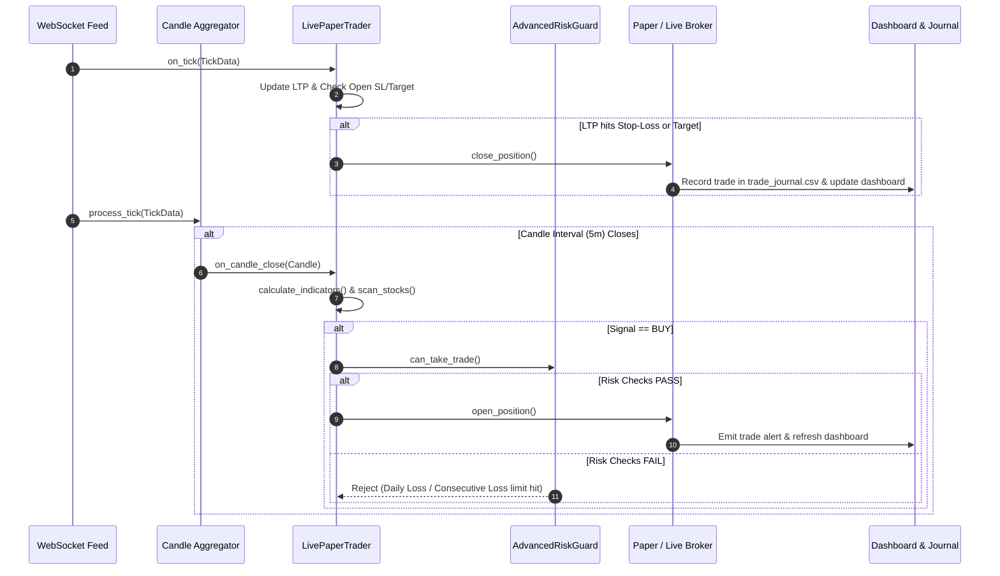

# Indian Day Trader – System Architecture

This document describes the architectural design, component interactions, data pipelines, and safety controls of the **Indian Day Trader** platform.

---

## 1. High-Level Architecture Diagram

---

## 2. Real-Time Event-Driven Data Flow

The platform operates on an asynchronous, event-driven pattern designed for millisecond latency on intraday trading ticks:

---

## 3. Subsystem Breakdown

### 3.1 Market Data Feed Subsystem
- **`BaseMarketDataFeed`**: Defines the subscriber contract, thread-safe callback registration, and connection lifecycles.
- **`SimulatedWebSocketFeed`**: Generates high-fidelity synthetic ticks adhering to NSE's ₹0.05 tick size or replays chronologically from pre-loaded historical CSV datasets with speed acceleration multipliers.
- **`LiveBrokerWebSocketFeed`**: Connects to official Indian broker WebSocket endpoints (Zerodha KiteTicker, Angel One SmartStream) with exponential backoff reconnects and heartbeat tracking.
- **`CandleAggregator`**: Thread-safe bucket aggregator that compiles granular incoming ticks into OHLCV candles, dispatching `on_candle_close` events strictly on timestamp boundaries.
- **`DataSourceVerifier`**: Enforces awareness of Yahoo Finance API restrictions (30-day limit for 1-minute data; 60-day limit for 5-minute data) before queries are dispatched.

### 3.2 Strategy & Analysis Subsystem
- **`StockScanner`**: Computes weighted scores across EMA trend confirmation (30 pts), RSI momentum (25 pts), MACD crossover (25 pts), and volume surge (20 pts), outputting ranked candidate setups.
- **`calculate_indicators_by_symbol`**: Isolates calculations on a per-symbol basis, ensuring that EMA smoothing filters do not bleed or cross-contaminate between tickers.
- **`MarketRegime`**: Classifies market context into Uptrend, Downtrend, Sideways, or High Volatility to select regime-optimal parameter sets.

### 3.3 Backtesting & Causal Validation Subsystem
- **`split_market_data`**: Chronologically partitions multi-asset market data using distinct timestamps, ensuring all assets on a given bar remain in the same partition.
- **`check_data_leakage` & `validate_strategy`**: Verifies that the maximum training timestamp is strictly prior to the minimum testing timestamp, confirming zero lookahead contamination or state leakage.
- **`WalkForwardBacktester` & `ValidationGate`**: Evaluates strategies across rolling out-of-sample folds, rejecting strategies that fail stability, trade count, or drawdown criteria.
- **`MonteCarloSimulator` & `SlippageSensitivity`**: Stochastically reorders trade sequences and applies parametric slippage sweeps to stress-test ruin probabilities.

### 3.4 Multi-Tier Risk Subsystem
- **Tier 1 (Market Session)**: Enforces Indian equity market hours (09:15 - 15:30 IST), cuts off entries at 15:15 IST, and triggers auto-square-off at 15:20 IST.
- **Tier 2 (Daily Loss & Trades)**: Halts execution when realized/unrealized loss exceeds the daily INR threshold or maximum trades per day is reached.
- **Tier 3 (Consecutive Loss Breaker)**: Pauses new trade allocations after a sequence of losing trades (default: 3) until manual review or next market session.
- **Tier 4 (Index Circuit Breaker)**: Tracks benchmark moves against SEBI's 10%, 15%, and 20% circuit breaker limits to halt operations during market halts.
- **Tier 5 (Transaction Cost Engine)**: Applies exact Indian regulatory taxes and broker fees (STT, GST, Stamp Duty, SEBI turnover fees, exchange transaction fees).

### 3.5 Execution & Safety Subsystem
- **`PortfolioPaperBroker`**: Multi-asset paper execution engine managing capital, margin requirements, trade journals, and P&L accounting.
- **`OrderExecutionEngine`**: Sits directly in front of live broker API connections:
  - **Kill-Switch**: Default engaged; requires explicit confirmation (`I_CONFIRM_LIVE_TRADING`) to disengage.
  - **Fat-Finger Guard**: Rejects individual orders whose notional value exceeds the threshold (e.g., ₹50,000).
  - **Turnover Limit**: Caps aggregate cumulative daily volume (e.g., ₹2,00,000).
  - **Dry-Run Mode**: Full routing through validation and risk checks without hitting external networks.
- **`ZerodhaBroker` & `AngelOneBroker`**: Concrete adapters mapping normalized `Order` objects to REST API endpoints for Kite Connect and SmartAPI.
